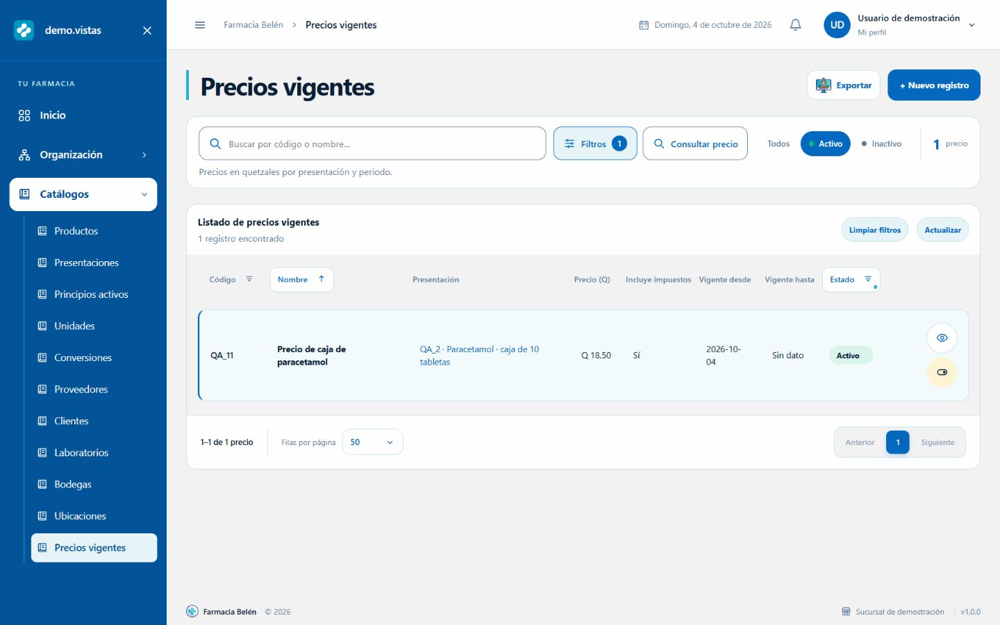
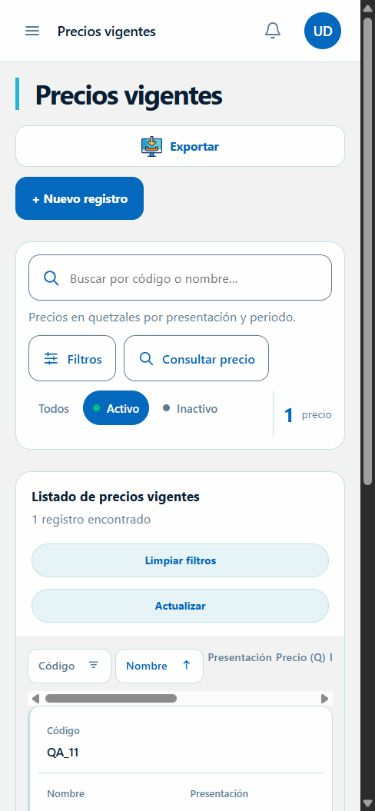
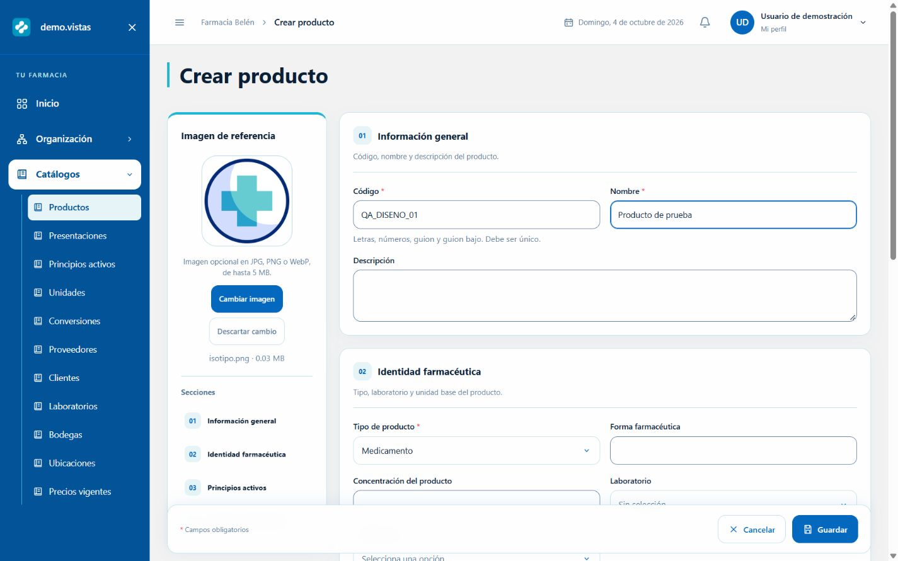
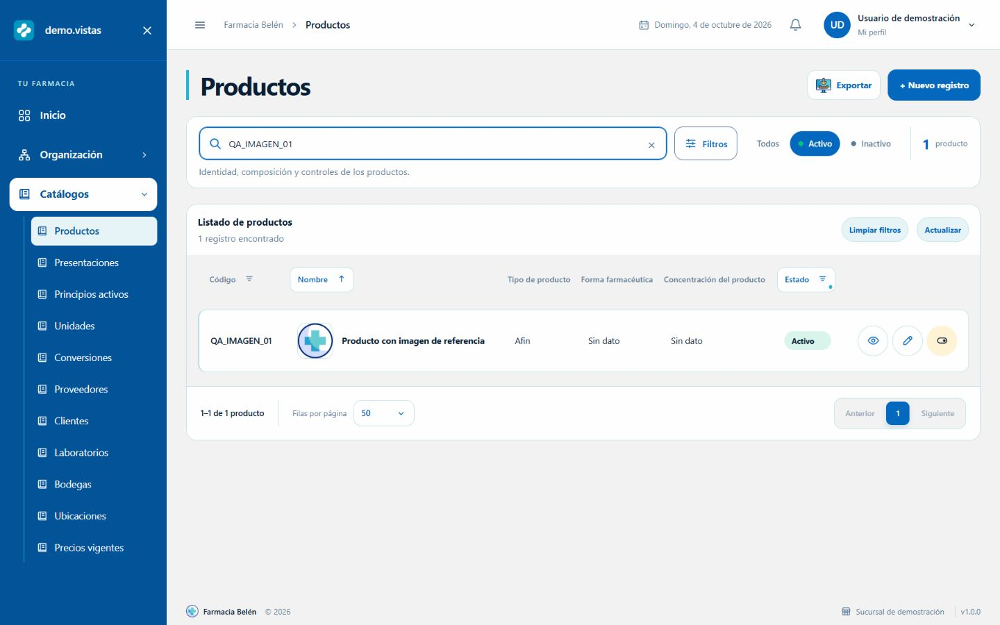
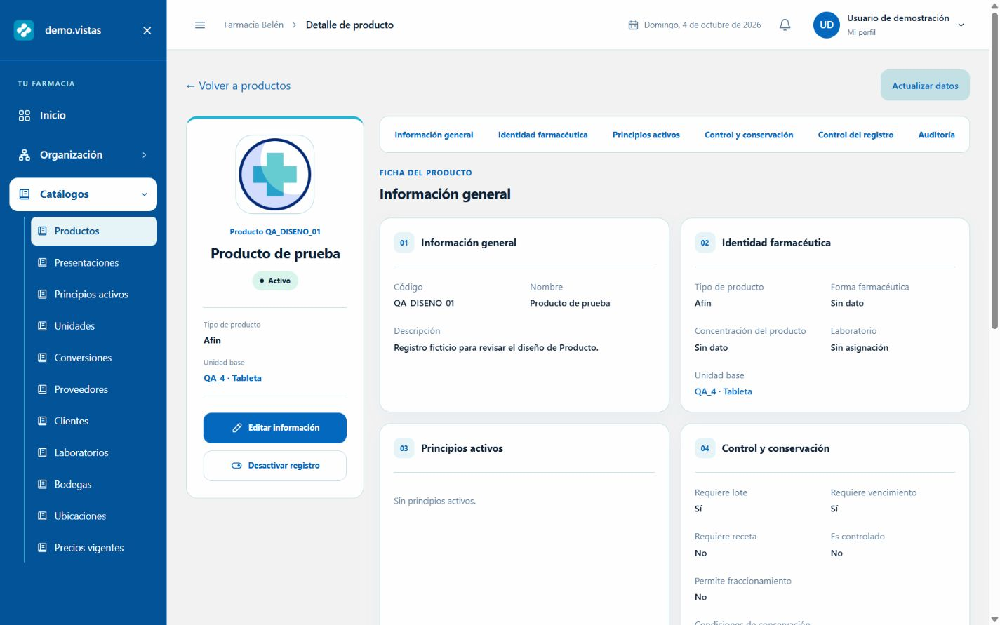
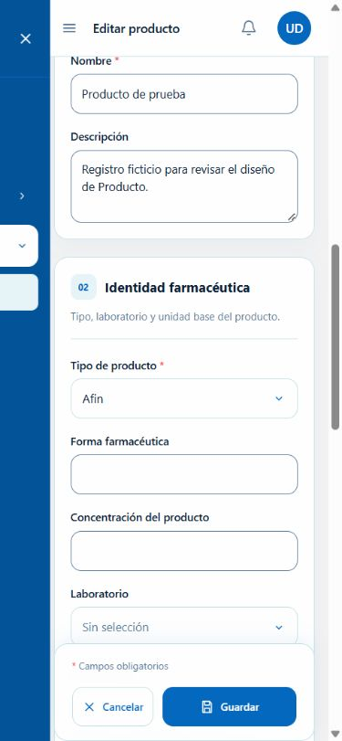
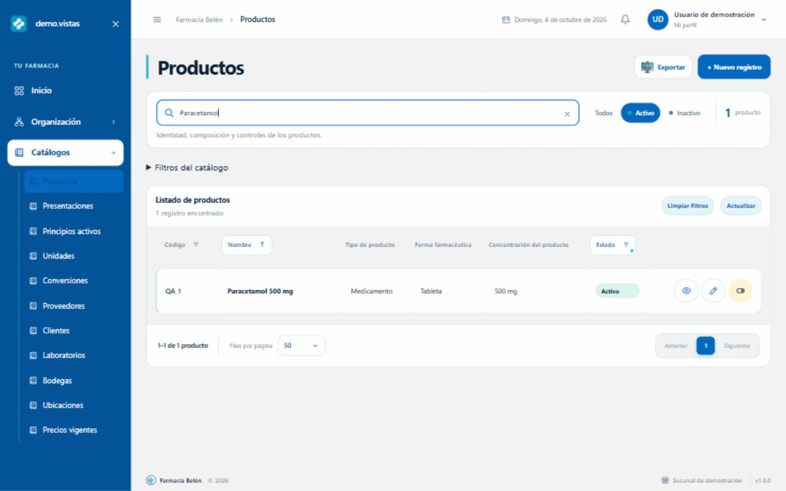
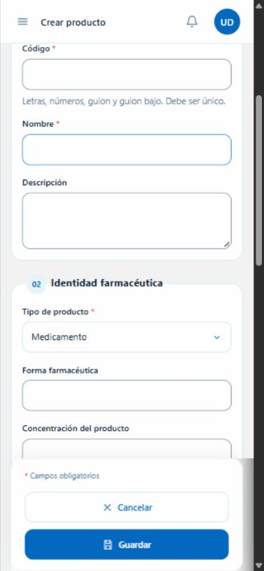

# Vistas de catálogos maestros de farmacia

Se implementaron listados, creación, edición y detalle para los once catálogos. Reutilizan la paleta, los estilos de gestión y formularios, las tablas en apariencia de tarjetas, los selectores, la paginación, los modales y la auditoría usados por los módulos existentes de empleados y organización.

| Catálogo | Ruta | Permisos |
| --- | --- | --- |
| Productos | `/catalogos/productos` | `CATALOGOS.PRODUCTOS.*` |
| Presentaciones | `/catalogos/presentaciones` | `CATALOGOS.PRESENTACIONES.*` |
| Principios activos | `/catalogos/principios-activos` | `CATALOGOS.PRINCIPIOS_ACTIVOS.*` |
| Unidades | `/catalogos/unidades` | `CATALOGOS.UNIDADES.*` |
| Conversiones | `/catalogos/conversiones` | `CATALOGOS.CONVERSIONES.*` |
| Proveedores | `/catalogos/proveedores` | `CATALOGOS.PROVEEDORES.*` |
| Clientes | `/catalogos/clientes` | `CATALOGOS.CLIENTES.*` |
| Laboratorios | `/catalogos/laboratorios` | `CATALOGOS.LABORATORIOS.*` |
| Bodegas | `/catalogos/bodegas` | `CATALOGOS.BODEGAS.*` |
| Ubicaciones | `/catalogos/ubicaciones` | `CATALOGOS.UBICACIONES.*` |
| Precios vigentes | `/catalogos/precios-vigentes` | `CATALOGOS.PRECIOS_VIGENTES.*` |

Cada ruta admite `/nuevo`, `/:id` y `/:id/editar`. Las opciones se incorporaron al menú lateral y al dashboard. Ver y exportar requieren `VER`; las demás acciones usan `CREAR`, `ACTUALIZAR`, `INACTIVAR` o `VER_AUDITORIA`, según corresponda. Homologar requiere `CATALOGOS.PROVEEDORES.HOMOLOGAR`.

## Comportamiento

- Búsqueda y filtros enviados al servidor; ordenamiento por código, nombre o estado. Los filtros específicos aparecen en «Filtros del catálogo».
- Paginación inicial de 50, con opciones de 50, 100, 150 y 200. Reinicio de página al cambiar criterios y corrección al disminuir el total.
- Exportación PDF y Excel con los mismos filtros, sin limitarse a la página visible.
- Selectores de relaciones con búsqueda remota y carga de más opciones, sin truncar el catálogo a los primeros registros. Se conserva la referencia seleccionada durante la edición.
- Referencias mostradas por código y nombre, con acceso al detalle cuando hay permiso. Municipios obtenidos mediante los endpoints geográficos existentes.
- Estados de carga, errores con reintento, ausencia de registros y ausencia de coincidencias. Los resultados anteriores no se muestran como una consulta recién completada.
- Validación junto a los campos, foco al primer error, protección de cambios pendientes y bloqueo de envíos duplicados.
- Desactivación con motivo, versión y explicación del efecto. El historial se conserva; no se ofrece eliminación ni reactivación.
- Detalles organizados en tarjetas y pista de auditoría con filtros, paginación y comparación de cambios.

## Reglas particulares

- **Productos:** composición dinámica de hasta veinte principios activos, concentración, laboratorio, unidad base, trazabilidad, receta, control, fraccionamiento y conservación. Cuando se comprueban presentaciones activas, se bloquean los campos de identidad y trazabilidad que el backend protege.
- **Presentaciones:** producto, unidad y contenido inmutables al editar; el formulario informa la unidad base y la autorización de fraccionamiento del producto seleccionado.
- **Unidades:** una unidad de empaque no admite decimales. Las restricciones adicionales por uso se validan en el backend.
- **Conversiones:** unidades diferentes, factor exacto en texto y periodo de vigencia. No se ofrece edición cuando comenzó la vigencia. El backend comprueba consistencia del grafo y solapamientos.
- **Proveedores:** comienzan en evaluación. Homologación en un diálogo independiente con motivo. El NIT de un proveedor aprobado no se modifica.
- **Clientes:** tipo inmutable; el cliente genérico usa CF, no acepta datos personales y no se puede desactivar. Una dirección requiere municipio. El listado no muestra identificadores ni contacto privados.
- **Bodegas y ubicaciones:** asignaciones inmutables. La sucursal actual restringe los selectores cuando falta acceso corporativo. El backend conserva la comprobación de alcance.
- **Precios:** GTQ, importe exacto en texto, indicador de impuestos y periodo. Los precios iniciados no se editan. Se ofrecen cierre de vigencia con motivo y consulta de precio vigente por presentación y fecha.

La verificación definitiva de referencias activas, unicidad, dependencias, alcance, concurrencia y periodos corresponde al backend. Para seleccionar relaciones, el usuario necesita el permiso de consulta del catálogo relacionado; si falta, la vista lo informa. Una creación sin permiso `VER` vuelve al inicio después de guardar.

## Organización del código

- `src/modules/catalogos-farmacia/catalogos.config.ts`: campos, secciones, filtros y particularidades de los once catálogos.
- `catalogo.types.ts`, `catalogo-api.ts`, `catalogo-reglas.ts` y `catalogo-rutas.ts`: tipos, contratos HTTP, validación y rutas.
- `components/`: composición reutilizable de listado, formulario, detalle, auditoría, operaciones y referencias.
- `catalogos.module.css`: ajustes de composición y accesibilidad con los tokens existentes; no define otra paleta.

Se amplió el selector compartido con búsqueda remota, carga de opciones y estados de resultado. El comportamiento de selección local se conserva. Los enlaces de navegación de secciones desplazan el formulario sin abandonarlo; el control de rutas también ignora cambios de hash dentro de la misma pantalla.

## Filtros compactos

Los filtros adicionales de los ocho catálogos que los utilizan se abren desde el botón **Filtros**, junto a la búsqueda. Un contador indica cuántos criterios adicionales están aplicados. El usuario ajusta un borrador y pulsa **Aplicar filtros** para consultar el servidor y volver a la primera página. **Limpiar** vacía el borrador; cerrar o pulsar Escape conserva los criterios anteriores. La búsqueda, los estados rápidos y los filtros por columna siguen disponibles.

En precios vigentes, **Consultar precio** abre un diálogo independiente para la presentación, la fecha y el resultado. Ambos controles ocupan la barra de herramientas; no añaden bloques permanentes encima del listado.

Se reutilizaron `HerramientasListado` con acciones opcionales y `ModalEstado` con apariencia de formulario. Los usos anteriores conservan la apariencia predeterminada. Los diálogos mantienen cierre con Escape, foco dentro del panel y retorno al botón de origen; los selectores siguen permitiendo búsqueda remota.

La revisión del rediseño comprobó los once listados, los ocho paneles de filtros, aplicación, cancelación, limpieza, contador, consulta de precio y teclado. Se verificaron escritorio (1440×900) y móvil (390×844), sin desbordamiento horizontal de la página, con datos ficticios en memoria.





## Imagen de referencia de Producto

Producto permite seleccionar una imagen opcional al crear o editar, con vista previa y los controles y la paleta reutilizados del módulo de Empleado. Admite JPG, PNG y WebP de hasta 5 MB. La imagen se muestra como miniatura en el listado y en la cabecera del detalle, conservando sus proporciones. Se puede cambiar, descartar una selección o marcar la imagen actual para eliminarla al guardar.

Creación y edición reutilizan la distribución de Empleados: panel lateral con imagen centrada, controles y navegación de secciones, datos a la derecha y barra de acciones a lo ancho del formulario. Se reutilizan sus estilos para el marco de imagen, secciones numeradas, descripciones y acciones. En detalle se reutilizan el perfil centrado con imagen de 7 rem, el resumen, las acciones y las tarjetas de Empleados. En móvil el panel se coloca encima de los datos. `NavegacionSecciones` admite una clase opcional para reutilizar estos estilos, manteniendo su comportamiento de navegación existente.

Los datos del producto se guardan primero y la imagen se envía después mediante multipart, con la versión devuelta por el backend. Si los datos se guardan pero falla la imagen, un diálogo informa el resultado y permite reintentar únicamente la imagen o continuar. El reintento conserva la versión esperada y no crea nuevamente el producto. Cambiar o eliminar la imagen requiere el permiso existente `CATALOGOS.PRODUCTOS.ACTUALIZAR`.

La lectura usa la URL autenticada del backend, credenciales y versión del registro para actualizar la imagen al reemplazarla. Antes de utilizarlo en el entorno real debe aplicarse la migración del backend `1791158400000-ImagenReferenciaProducto`; no requiere un seed nuevo.

Se verificaron creación, detalle, edición, eliminación, archivo no permitido, protección de cambios pendientes y recuperación de una carga fallida sin duplicación, en escritorio y móvil. La revisión utilizó un producto ficticio y el isotipo existente como imagen de prueba, con un servidor en memoria y sin modificar Oracle. Para reproducir el fallo inicial de carga en ese servidor puede definirse `QA_FALLAR_PRIMERA_IMAGEN=1` antes de iniciarlo.










## Validación realizada

```powershell
npm run build
npm run lint
npm run test:catalogos-farmacia
```

Las 30 pruebas comprueban entradas y filtros de los once formularios contra los validadores Zod reales del backend, rutas y permisos, precisión decimal, reglas de medicamentos y clientes, periodos, versiones y contratos de API, además de validación y envío multipart de la imagen de Producto. No inicializan Oracle.

Se revisaron en el navegador los once listados, los once formularios de creación, los once detalles con auditoría y las ediciones permitidas. También se verificaron creación, edición, desactivación, homologación, cierre de precio, búsqueda de una referencia fuera de los primeros cincuenta registros, carga adicional con teclado, búsquedas vacías y navegación con cambios pendientes. Se revisaron escritorio y móvil a 1440×900 y 390×844, con campos sin desbordamiento horizontal.

La compilación termina correctamente. Vite mantiene un aviso de tamaño del paquete principal, mayor que 500 kB; no impide generar los archivos de producción.

Las interacciones visuales utilizaron datos ficticios en memoria. No se ejecutaron migraciones ni seeds ni se modificó la base de datos. La integración HTTP real, los archivos PDF/Excel generados por el backend y las transacciones Oracle requieren comprobarse con el entorno configurado.

## Repetir la revisión visual sin base de datos

En una terminal, desde el frontend:

```powershell
node tests/servidor-vistas-catalogos.cjs
```

En otra terminal:

```powershell
$env:VITE_API_URL = 'http://127.0.0.1:4319/api'
npm run dev -- --host 127.0.0.1 --port 5181 --strictPort
```

Abrir `http://127.0.0.1:5181/catalogos/productos`. El servidor de demostración escucha únicamente en localhost, usa permisos ficticios y conserva todas las modificaciones en memoria. Se detiene con Ctrl+C. No es una sustitución de las pruebas de integración con el backend real ni un modo de autenticación del frontend de producción.

Capturas con datos ficticios:




