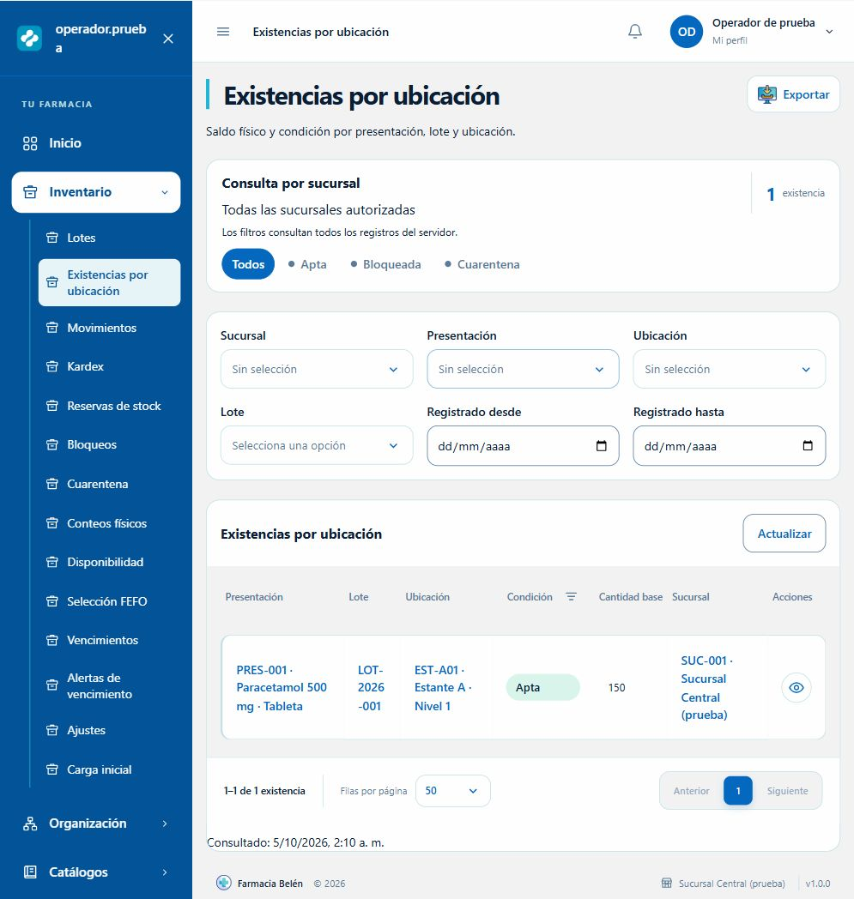

# Vistas de Inventario

El módulo utiliza la composición de Empleados: menú lateral azul, títulos con acento cian, superficies claras, tablas en apariencia de tarjetas, formularios por secciones y fichas con resumen lateral. Reutiliza los tokens efectivos de `variables.css` y los componentes compartidos de gestión, selección, paginación, exportación, modales y auditoría.

## Pantallas y operaciones

| Pantalla | Ruta | Alcance |
| --- | --- | --- |
| Lotes | `/inventario/lotes` | Listado, registro, detalle, fechas y origen |
| Existencias por ubicación | `/inventario/existencias` | Saldos por presentación, lote y condición; acceso al kardex de una posición |
| Movimientos | `/inventario/movimientos` | Registro de hasta 100 líneas, detalle, confirmación y anulación de pendientes |
| Kardex | `/inventario/kardex` | Entradas, salidas, saldos y referencias de operaciones confirmadas |
| Reservas | `/inventario/reservas` | Registro, preparación por FEFO, cancelación, vigencia y cierre de expiradas por sucursal |
| Bloqueos | `/inventario/bloqueos` | Restricciones de producto, lote o ubicación; levantamiento operativo y bloqueo de cantidades |
| Cuarentena | `/inventario/cuarentenas` | Casos, cantidades segregadas, detalle y registro de segregación |
| Conteos físicos | `/inventario/conteos` | Apertura, captura, cierre, conciliación y cancelación |
| Disponibilidad | `/inventario/disponibilidad` | Stock físico, apto, reservado, disponible, restringido, en cuarentena y vencido |
| FEFO | `/inventario/fefo` | Consulta de posiciones para una cantidad, unidad y vida útil mínima |
| Vencimientos | `/inventario/vencimientos` | Lotes, fechas, días restantes y clasificación de alertas |
| Alertas de vencimiento | `/inventario/parametros` | Consulta y configuración corporativa de los tres umbrales |
| Ajustes | `/inventario/ajustes` | Formulario de ajuste positivo o negativo |
| Carga inicial | `/inventario/carga-inicial` | Formulario de apertura con fecha de corte |

Los ocho recursos admiten detalle `/:id`. Lotes, movimientos, reservas, bloqueos y conteos admiten `/nuevo`. Ajustes y carga inicial también admiten `/nuevo` y se consultan después como movimientos. La captura está en `/inventario/conteos/:id/resultados`.

Las existencias y el kardex se consultan; sus saldos se actualizan mediante las operaciones del backend. La liberación sanitaria, las bajas y la destrucción están contempladas en el contexto de cuarentena y bloqueos sanitarios, y quedan para su etapa de backend. No se presentan acciones operativas para endpoints que todavía no existen.

## Contratos y reglas

- Filtros y paginación consultan el servidor completo. Se ofrecen únicamente los criterios que el backend aplica a cada recurso; no se añade búsqueda u ordenamiento general sin soporte del endpoint. La auditoría sí permite fecha y ordenamiento.
- Tamaño inicial de 50, con opciones de 50, 100, 150 y 200; cambio de criterios reinicia la página. Estados rápidos y filtros por columna mantienen el mismo criterio de estado.
- Los ocho recursos exportan PDF y Excel con los filtros actuales, sin paginación. Vencimientos, disponibilidad y FEFO no ofrecen una exportación sin endpoint.
- Las cantidades y costes se conservan como texto decimal exacto. Se admiten hasta nueve enteros y seis decimales; cero solo en costes y resultados de conteo.
- Los movimientos se guardan pendientes. La confirmación actualiza existencias y kardex; los confirmados no se editan ni se anulan mediante la acción de pendientes. Reubicar conserva la condición sanitaria del origen.
- Selección de origen por sucursal y presentación; destino por bodega. Las opciones muestran referencias, lote, condición y cantidad base. Los selectores de inventario cargan páginas adicionales, y los de catálogos conservan su búsqueda remota.
- Crear una reserva expresa un compromiso; preparar asigna stock apto por FEFO. Consultar FEFO no reserva ni descuenta existencias. Las fechas y horas de reserva usan Guatemala (UTC−06:00).
- Abrir un conteo congela la ubicación. Guardar cantidades no cambia stock. Se capturan de 1 a 200 posiciones por operación, incluyendo cero y unidades encontradas; los borradores se conservan entre páginas. Cerrar bloquea edición y conciliar aplica los ajustes. Los movimientos derivados de conteos se resuelven mediante el conteo.
- Operaciones con versión y justificantes según su contrato. Los conflictos permiten recargar el registro; no se reenvía silenciosamente una versión nueva. Creaciones de documentos con idempotencia conservan la clave durante el reintento.
- Se incluyen validaciones, carga, vacío, ausencia de coincidencias, error con reintento, protección de cambios pendientes y bloqueo de envíos duplicados.

## Permisos

La navegación y las acciones respetan los códigos `INVENTARIO.*` existentes. La lectura usa `VER` del recurso; FEFO usa `INVENTARIO.DISPONIBILIDAD.FEFO`, ajustes y carga inicial usan su permiso `CREAR`. Cuarentena usa el grupo singular `INVENTARIO.CUARENTENA`.

Confirmar o anular un movimiento utiliza el grupo correspondiente a su tipo. Capturar conteos exige `CONTEOS.VER` y `CONTEOS.REGISTRAR`; conciliar exige `CONTEOS.CONCILIAR` y `AJUSTES.CONFIRMAR`. La auditoría requiere `ACCESO.VER_AUDITORIA`. Modificar parámetros requiere `VENCIMIENTOS.CONFIGURAR` y `ACCESO.CORPORATIVO`.

Sin acceso corporativo, la sucursal es la de la sesión. Los lotes tienen identidad compartida; filtrar por sucursal consulta su presencia en existencias. Elegir referencias requiere los permisos de consulta de los catálogos relacionados. La validación definitiva de alcance, relaciones, conversiones, aptitud y concurrencia sigue en el backend.

## Componentes compartidos

Se añadieron criterios opcionales a los selectores de referencias para acotar bodegas y ubicaciones, selección única opcional al filtro por columna y paginación remota sin búsqueda al selector de inventario. Los usos existentes mantienen su comportamiento. El submódulo activo conserva su fondo claro al pasar el cursor, evitando texto azul sobre fondo azul.

## Verificación

Desde `Frontend/FarmaciaBelenFrontend`:

```powershell
npm run build
npm run lint
npm run test:inventario
npm run test:catalogos-farmacia
```

Las 15 pruebas de Inventario contrastan formularios, tipos de movimiento, permisos, precisión, métodos HTTP, versiones, FEFO y exportaciones con los validadores reales del backend. Las 30 pruebas de Catálogos verifican la regresión de los recursos compartidos. No requieren Oracle y no ejecutan migraciones ni seeds. La compilación emite el aviso habitual de Vite sobre el tamaño del paquete JavaScript; el build finaliza correctamente.

La revisión visual usa la aplicación real con HTTP simulado en memoria. Se comprobaron navegación, listados, detalles, creación de lote con teclado, confirmación de movimiento, captura de cero en conteo, disponibilidad, FEFO, filtros, cambios pendientes y error con reintento. Se revisaron escritorio y móvil (390×844), sin desbordamiento horizontal de página. Esta revisión no sustituye una prueba con la sesión y los datos reales del servidor.

Entrada de revisión aislada, exclusiva de desarrollo:

```powershell
$env:VITE_API_URL = 'http://127.0.0.1:5187/api'
npm run dev -- --host 127.0.0.1 --port 5187 --strictPort
```

Abrir `/tests/visual-inventario/index.html` en ese servidor. `?error=1` simula un error recuperable; `?vacio=1` muestra listados vacíos; `?ruta=/inventario/fefo` inicia otra pantalla. Las escrituras solo afectan la memoria del navegador, y esa entrada no forma parte del build de producción. Al terminar, detener ese proceso y restaurar `VITE_API_URL` antes de iniciar el frontend contra el backend real.



[Captura móvil con datos simulados](capturas/inventario-existencias-movil.png)

La valoración económica, el kardex monetario, las reposiciones documentadas, las sugerencias de precio aprobadas y el costo histórico de ventas se describen en [Costeo de inventario y precios](costeo-inventario-precios.md). La migración y el seed de permisos de esta ampliación están preparados sin ejecutar en Oracle.
